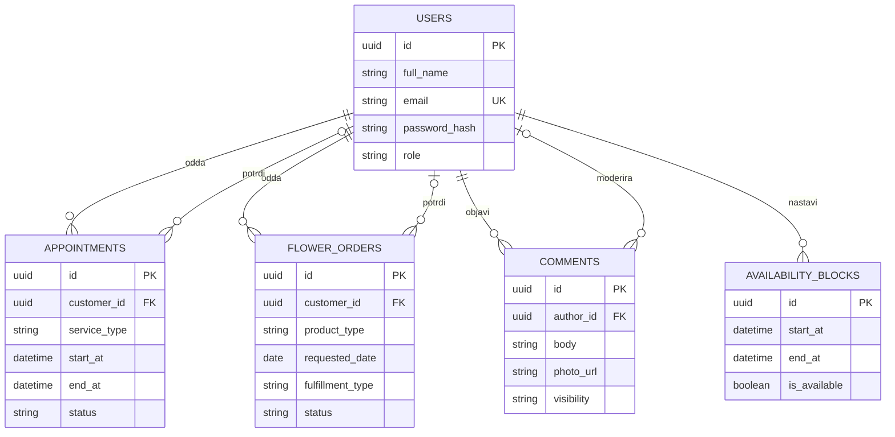

# 3. Podatkovni model – UNIKAT

## Izbrani pristop
Predvidena je relacijska podatkovna baza **PostgreSQL**. Povezave med uporabniki, rezervacijami, naročili in komentarji so relacijske, zato je mogoče ohraniti referenčno celovitost in učinkovito poizvedovati po datumih ter statusih.

## Entitete in glavna polja

### `users` – uporabniki
| Polje | Tip / namen |
|---|---|
| `id` | UUID, primarni ključ |
| `full_name` | Ime in priimek |
| `email` | E-poštni naslov, unikaten |
| `password_hash` | Varno zgoščena vrednost gesla; nikoli geslo v čisti obliki |
| `role` | `CUSTOMER`, `OWNER` ali `ADMIN` |
| `phone` | Telefonska številka, neobvezna |
| `created_at` | Čas nastanka računa |
| `is_active` | Ali je račun aktiven |

### `appointments` – rezervacije terminov
| Polje | Tip / namen |
|---|---|
| `id` | UUID, primarni ključ |
| `customer_id` | Tuji ključ na `users.id` |
| `service_type` | `CONSULTATION` ali `MAKEUP` |
| `start_at` | Začetek termina |
| `end_at` | Konec termina |
| `status` | `PENDING`, `APPROVED`, `REJECTED` ali `CANCELLED` |
| `customer_note` | Opomba stranke, neobvezna |
| `owner_note` | Interna opomba lastnice, neobvezna |
| `reviewed_by` | Tuji ključ na `users.id`, neobvezen |
| `reviewed_at` | Čas odločitve, neobvezen |
| `created_at` | Čas oddaje zahteve |

### `flower_orders` – naročila šopkov in aranžmajev
| Polje | Tip / namen |
|---|---|
| `id` | UUID, primarni ključ |
| `customer_id` | Tuji ključ na `users.id` |
| `product_type` | Vrsta izdelka, npr. šopek ali aranžma |
| `size` | Velikost, npr. manjši, srednji ali večji |
| `quantity` | Količina, pozitivno celo število |
| `requested_date` | Želeni datum prevzema/dostave |
| `fulfillment_type` | `PICKUP` ali `DELIVERY` |
| `customer_note` | Želje glede barv, cvetja ali priložnosti |
| `status` | `PENDING`, `APPROVED`, `REJECTED`, `COMPLETED` ali `CANCELLED` |
| `reviewed_by` | Tuji ključ na `users.id`, neobvezen |
| `reviewed_at` | Čas odločitve, neobvezen |
| `created_at` | Čas oddaje naročila |

### `comments` – komentarji
| Polje | Tip / namen |
|---|---|
| `id` | UUID, primarni ključ |
| `author_id` | Tuji ključ na `users.id` |
| `body` | Besedilo komentarja |
| `photo_url` | Pot oziroma URL naložene fotografije, neobvezen |
| `visibility` | `VISIBLE` ali `HIDDEN` |
| `created_at` | Čas objave |
| `moderated_by` | Tuji ključ na `users.id`, neobvezen |
| `moderated_at` | Čas moderiranja, neobvezen |

### `availability_blocks` – razpoložljivost lastnice
| Polje | Tip / namen |
|---|---|
| `id` | UUID, primarni ključ |
| `start_at` | Začetek nedostopnega obdobja ali delovnega termina |
| `end_at` | Konec obdobja |
| `is_available` | Ali je obdobje na voljo za rezervacijo |
| `label` | Opis, npr. »dopust« ali »delovni termin« |
| `created_by` | Tuji ključ na `users.id` |

## Povezave med entitetami

- En uporabnik (`users`) lahko odda več rezervacij (`appointments`): **1 : N**.
- En uporabnik (`users`) lahko odda več naročil (`flower_orders`): **1 : N**.
- En uporabnik (`users`) lahko objavi več komentarjev (`comments`): **1 : N**.
- Lastnica ali administrator lahko pregleda več rezervacij in naročil; polji `reviewed_by` se sklicujeta na `users.id`.
- Lastnica ali administrator lahko moderira več komentarjev; `moderated_by` se sklicuje na `users.id`.
- `availability_blocks` določa obdobja, ki jih je treba upoštevati pri prikazu prostih terminov.

## Osnutek ER-diagrama

## Pomembna poslovna pravila in omejitve

1. Datum naročila šopka mora biti od današnjega datuma do enega koledarskega meseca vnaprej. Preverjanje mora potekati na strežniku, ne samo v obrazcu.
2. Zahteva za termin sama po sebi še ne pomeni potrjene rezervacije. Potrdi jo lahko samo lastnica oziroma ustrezno pooblaščena vloga.
3. Sistem ne sme potrditi dveh rezervacij, ki se časovno prekrivata. Preverjanje prekrivanja se izvede na strežniku in ob potrjevanju.
4. Uporabnik lahko ureja svoje podatke in zahteve, ne pa zahtev drugih strank.
5. Fotografije morajo biti omejene po velikosti in dovoljenih vrstah datotek. V bazi se shrani pot oziroma URL datoteke, ne binarna vsebina fotografije.
6. Za dnevni e-poštni povzetek je priporočljivo shraniti evidenco poslanih povzetkov ali uporabiti oznako obdelave, da se isti povzetek po nepotrebnem ne pošlje večkrat.
