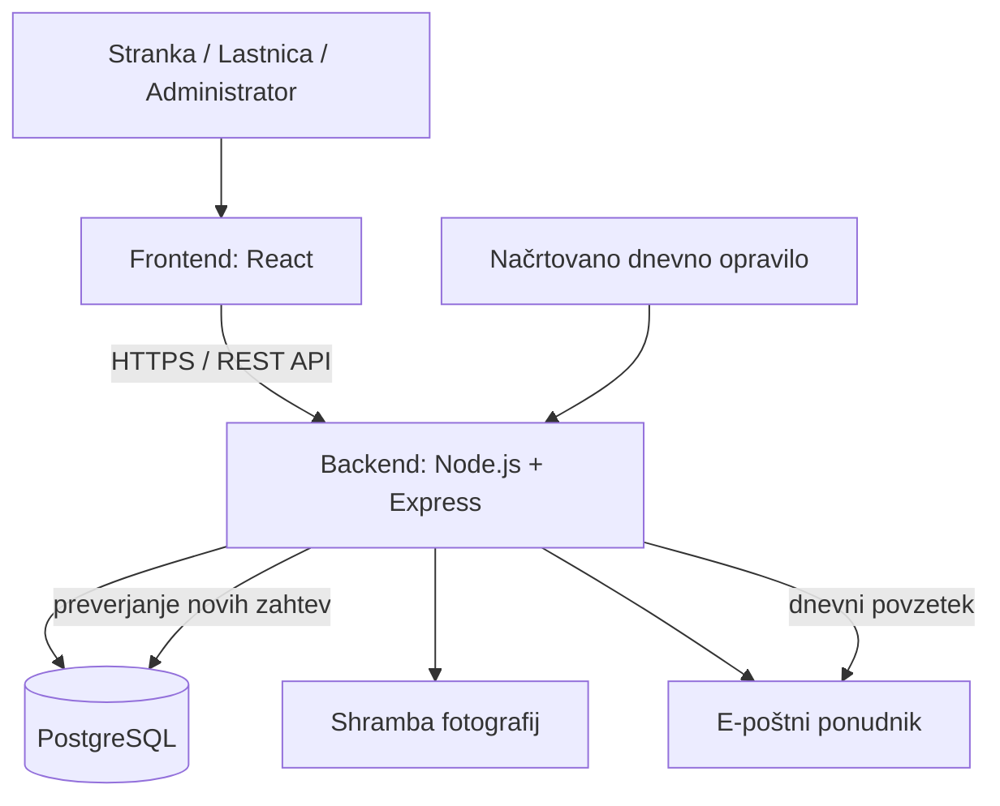

# 4. Arhitektura in tehnološki sklad – UNIKAT

## Predlagana arhitektura

Aplikacija bo klasična spletna aplikacija s frontend vmesnikom, backend API-jem in relacijsko podatkovno bazo. Frontend bo prikazoval koledar, obrazce in uporabniške strani. Backend bo izvajal poslovna pravila, preverjal pravice, obdeloval naročila in komuniciral s podatkovno bazo ter e-poštnim ponudnikom.

### Glavni deli sistema
- **Frontend:** uporabniški vmesnik za stranke ter ločen skrbniški pogled za lastnico in administratorja.
- **Backend / API:** obdelava zahtev, avtentikacija, preverjanje vlog, preverjanje razpoložljivosti in statusov ter dostop do podatkov.
- **PostgreSQL:** trajno shranjevanje uporabnikov, rezervacij, naročil, komentarjev in razpoložljivosti.
- **Shramba fotografij:** lokalna mapa v razvoju ali objektna shramba v produkciji; v bazi je shranjena samo pot oziroma URL.
- **E-poštna storitev:** pošiljanje dnevnega povzetka lastnici ter po želji obvestil strankam.
- **Načrtovano opravilo:** enkrat dnevno zažene opravilo, ki poišče nove zahteve in pošlje povzetek, če obstajajo.

## Diagram arhitekture

## Komunikacija med deli
1. Uporabnik v brskalniku izvede dejanje, na primer odda naročilo šopka.
2. Frontend pošlje zahtevo backendu prek REST API-ja.
3. Backend preveri, ali je uporabnik prijavljen in ali ima dovoljenje za dejanje.
4. Backend preveri poslovna pravila, na primer dovoljeni datum naročila ali prekrivanje termina.
5. Če je zahteva veljavna, backend shrani podatke v PostgreSQL in vrne rezultat frontendu.
6. Dnevno opravilo po urniku poišče zahteve, oddane tisti dan. Če obstajajo, sestavi in pošlje e-poštni povzetek lastnici.

## Tehnološki sklad

| Področje | Predlagana tehnologija | Utemeljitev |
|---|---|---|
| Frontend | React + TypeScript | Komponentni vmesnik, dobra podpora za obrazce in koledar. |
| Oblikovanje | CSS Modules ali navaden CSS | Dovolj za odziven in prilagojen vmesnik brez dodatne kompleksnosti. |
| Koledar | React Big Calendar ali FullCalendar | Prikaz prostih, čakajočih in potrjenih terminov. |
| Backend | Node.js + Express + TypeScript | Enoten jezik na frontend in backend strani ter preprost REST API. |
| Podatkovna baza | PostgreSQL | Relacijski podatki, tuji ključi, omejitve in poizvedbe po datumih. |
| Dostop do baze | Prisma ORM | Tipiziran dostop do podatkov in upravljanje migracij. |
| Avtentikacija | Seja s piškotkom `HttpOnly`, gesla z Argon2 ali bcrypt | Gesla niso shranjena v čisti obliki; piškotek ni dostopen JavaScriptu v brskalniku. |
| Nalaganje fotografij | Lokalna shramba v razvoju; pozneje objektna shramba | Fotografije se hranijo ločeno od relacijskih podatkov. |
| E-pošta | SMTP prek Nodemailerja ali ponudnik transakcijske e-pošte | Omogoča pošiljanje dnevnega povzetka in obvestil. |
| Dnevno opravilo | node-cron v backendu | Preprosto načrtovanje dnevnega povzetka za manjši projekt. |
| Lokalni razvoj | Git, npm, Docker Compose za PostgreSQL, `.env` | Ponovljiv zagon in ločitev nastavitev od izvorne kode. |
| Testiranje | Vitest/Jest in Supertest | Preverjanje poslovnih pravil in API-jev. |

## Avtentikacija in pravice
- Registracija je namenjena strankam. Vloga `CUSTOMER` se dodeli samodejno.
- Račun `OWNER` se ustvari ročno oziroma prek začetne administrativne nastavitve; uporabnik si lastniških pravic ne more dodeliti sam.
- Vloga `ADMIN` je namenjena upravljanju računov in tehnični administraciji.
- Backend preverja pravice pri vsaki zaščiteni zahtevi. Skrit gumb v frontendu ni zadostna zaščita.
- Gesla se shranjujejo samo kot varne zgoščene vrednosti. Sejne piškotke je treba v produkciji uporabljati prek HTTPS.
- Stranka lahko dostopa samo do svojih naročil, rezervacij in profila.

## Dnevni e-poštni povzetek
Načrtovano opravilo se izvede vsak dan ob izbrani uri, na primer ob 18.00 po slovenskem času. Poišče naročila šopkov in rezervacije, ustvarjene v tekočem dnevu. Če ni novih zahtev, e-pošte ne pošlje. Če zahteve obstajajo, pošlje lastnici pregled vrste zahteve, imena stranke, želenega datuma in stanja. Časovni pas naj bo nastavljen na `Europe/Ljubljana`. V produkciji mora biti zagotovljeno, da se opravilo izvaja samo enkrat, če aplikacija teče v več instancah.

## Lokalni zagon
Predvideni postopek za razvojno okolje:

1. Namestiti Node.js LTS, npm, Git in Docker Desktop oziroma lokalni PostgreSQL.
2. Prenesti projekt in namestiti odvisnosti z `npm install`.
3. Zagnati PostgreSQL z `docker compose up -d db` (če se uporablja Docker Compose).
4. V datoteki `.env` nastaviti povezavo do baze, skrivnost seje in podatke za e-pošto. Datoteke `.env` se ne oddaja v repozitorij.
5. Ustvariti strukturo baze z migracijami, na primer `npx prisma migrate dev`.
6. Zagnati backend in frontend z razvojnima ukazoma, na primer `npm run dev`.
7. Za testiranje e-pošte uporabiti testni SMTP predal ali razvojni e-poštni strežnik, da se med razvojem ne pošiljajo nenamerna sporočila pravim uporabnikom.

Natančni ukazi bodo prilagojeni končni strukturi repozitorija.

## Arhitekturne odločitve

1. **Relacijska baza:** rezervacije in naročila imajo jasne povezave z uporabniki, zato PostgreSQL zagotavlja smiselne tuje ključe in konsistentnost.
2. **Backend preverja poslovna pravila:** omejitev enega meseca in preprečevanje dvojnih rezervacij ne smeta biti odvisna samo od frontend obrazca.
3. **Ločene vloge:** stranka, lastnica in administrator imajo različne pravice; vloga se preverja na strežniku.
4. **Ločeni statusi zahtev:** `PENDING`, `APPROVED` in `REJECTED` omogočajo lastnici nadzor nad tem, kaj je dokončno potrjeno.
5. **Fotografije zunaj baze:** večje datoteke se hranijo v shrambi, baza pa vsebuje le metapodatke oziroma URL.
6. **Načrtovano opravilo za e-pošto:** dnevni povzetek je avtomatiziran in ne zahteva, da lastnica vsak dan ročno pregleduje aplikacijo.
7. **Postopna izvedba:** najprej se implementirajo računi, koledar, rezervacije, naročila in dnevni povzetek; plačila in napredne funkcije ostanejo za kasnejše nadgradnje.
